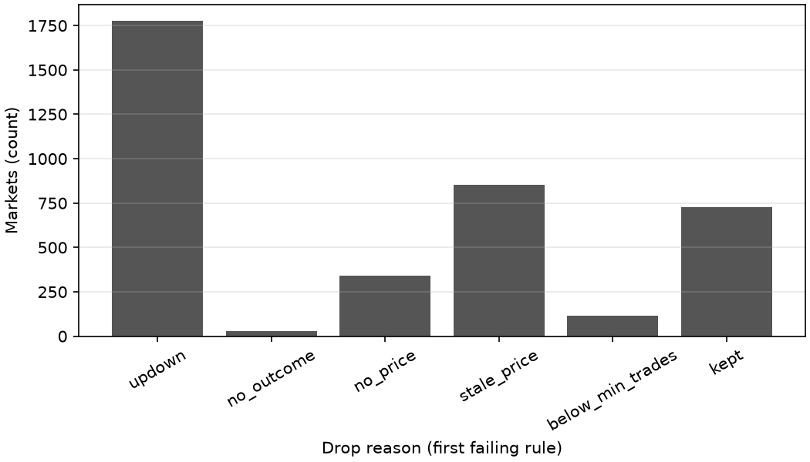

# Stage report: build_tables

**What:** Build the market table and the wallet table.

**Why:** Q1, Q2 and Q3 all read these two tables. Drop reasons are counted, nothing is imputed.

**Input data:** Real data, scope=pilot, T rule=close_at, min_trades=10, 3841 markets in scope (data/polymarket_v1/daily_aligned/*.parquet).

**Output data:** markets.parquet/csv (3841 rows), wallets.parquet (197543 rows), trade_sizes_sample.parquet (1000000 rows max, seed 42), tables_summary.json

**Result:** Kept 726 markets with the min_trades filter and 840 without it. Of the kept, 445 opened at least 7 days before T and 404 have a p_7d.

| reason | markets |
| --- | --- |
| stale_price | 851 |
| below_min_trades | 114 |
| kept | 726 |
| updown | 1778 |
| no_outcome | 29 |
| no_price | 343 |

**Figure:**   Caption: markets by first failing rule. Why: it shows which rule removes the most markets. Source: this run folder.

**Status:** ran
