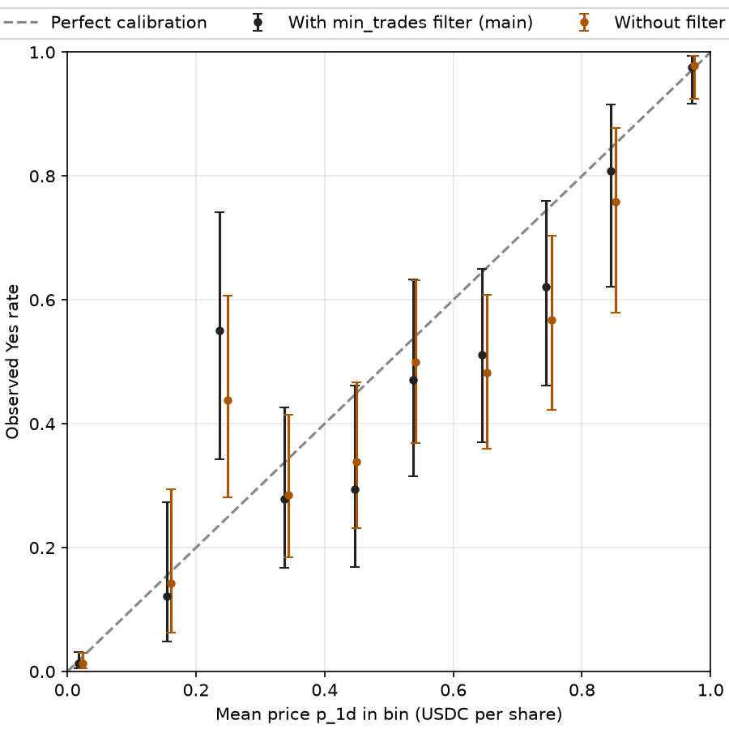
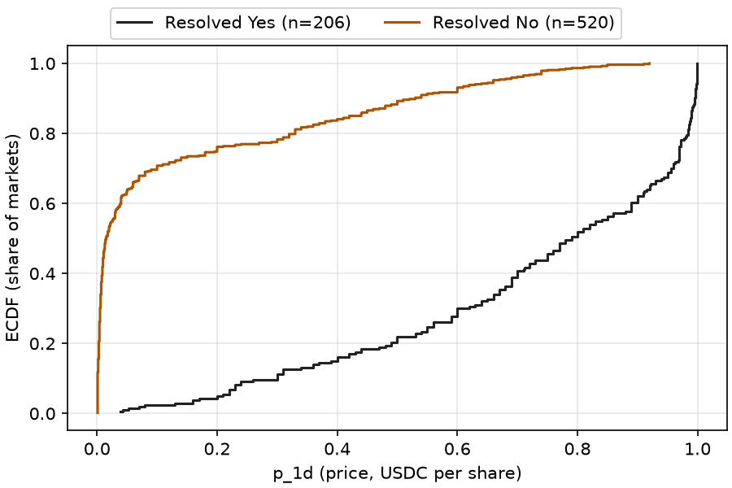

# Stage report: q1_calibration

**What:** Q1: calibration of the price 1 day before T.

**Why:** Q1: does the price 1 day before T match how often the outcome is Yes?

**Input data:** markets.parquet: 726 kept markets (with filter), 840 without the filter. T rule=close_at, min_trades=10. Real data.

**Output data:** q1_bins.csv, q1_bins_no_min.csv, q1_bins_eqfreq.csv, q1_results.json, q1_markets.csv, fig4_calibration.png, fig5_ecdf_yes_no.png

**Result:** | metric | with min filter | without filter |
| --- | --- | --- |
| n_markets | 726 | 840 |
| class_balance_yes | 0.2837 | 0.2988 |
| brier | 0.09229 | 0.1088 |
| log_loss | 0.2763 | 0.3203 |
| mean_entropy_bits | 0.3931 | 0.4478 |
| chi2 (df) | 22.7 (10), p=0.012 | 26.9 (10), p=0.00271 |
| chi2 effect w | 0.1768 | 0.1789 |
| KS D (Yes vs No) | 0.7159 | 0.6529 |

Bins rejected: Bonferroni 1, BH 1 of 10 (main).

| bin | n | mean_price | observed_rate | ci_low | ci_high | binom_p | p_bonferroni | p_bh |
| --- | --- | --- | --- | --- | --- | --- | --- | --- |
| 0 | 371 | 0.01702 | 0.01348 | 0.00577 | 0.03116 | 0.8394 | 1 | 0.9326 |
| 1 | 33 | 0.155 | 0.1212 | 0.04816 | 0.2733 | 0.8099 | 1 | 0.9326 |
| 2 | 20 | 0.237 | 0.55 | 0.3421 | 0.7418 | 0.002507 | 0.02507 | 0.02507 |
| 3 | 43 | 0.3374 | 0.2791 | 0.1675 | 0.4269 | 0.5194 | 1 | 0.837 |
| 4 | 34 | 0.4471 | 0.2941 | 0.1683 | 0.4617 | 0.0847 | 0.847 | 0.231 |
| 5 | 34 | 0.5379 | 0.4706 | 0.3145 | 0.6326 | 0.4928 | 1 | 0.837 |
| 6 | 45 | 0.6451 | 0.5111 | 0.37 | 0.6504 | 0.06319 | 0.6319 | 0.231 |
| 7 | 37 | 0.7438 | 0.6216 | 0.461 | 0.7594 | 0.09239 | 0.9239 | 0.231 |
| 8 | 26 | 0.8454 | 0.8077 | 0.6212 | 0.9149 | 0.5859 | 1 | 0.837 |
| 9 | 83 | 0.9707 | 0.9759 | 0.9163 | 0.9934 | 1 | 1 | 1 |

**Figure:**    Caption: observed Yes rate against mean price per bin with 95% Wilson CI, and ECDFs of p_1d by outcome. Why: points on the diagonal mean the price matches the outcome rate. Source: this run folder.

**Status:** ran
