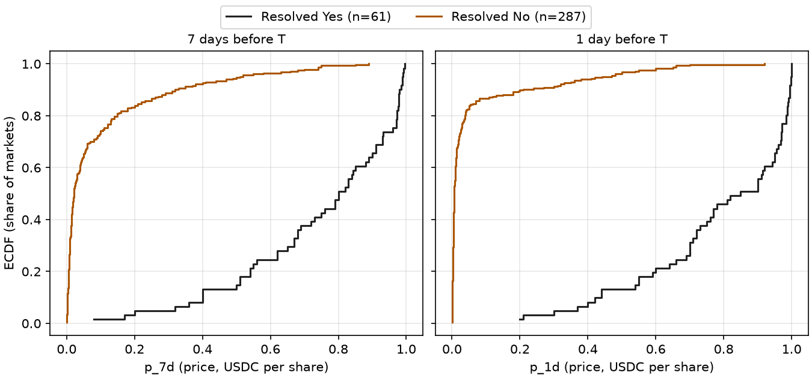

# Stage report: q1b_deadline

**What:** Q1b: does the market get smarter near the deadline?

**Why:** Q1b: is the price closer to the outcome 1 day before T than 7 days before T?

**Input data:** markets.parquet: 348 markets of 726 kept (445 opened >= 7 d before T). Both prices at most 24 h old. Real data.

**Output data:** q1b_markets.csv, q1b_table.csv, q1b_results.json, fig10_ecdf_7d_vs_1d.png

**Result:** Primary: one-sample t-test of Brier difference (7 d - 1 d): mean=0.01612, 95% CI [0.004782, 0.02747], t=2.796 (df 347), p=0.00546, Cohen's d=0.14989106737566904. Positive mean = better near the deadline.

Absolute error difference (7 d - 1 d): mean=0.03912, 95% CI [0.02533, 0.05291], p=4.87e-08, Cohen's d=0.29908538024899195.

The entropy drop is expected by construction: prices move toward 0 or 1 near the deadline. The error change is the real test.

| quantity | value | p |
| --- | --- | --- |
| Brier (7 d) | 0.05343 |  |
| Brier (1 d) | 0.03731 |  |
| mean H(p) bits (7 d) | 0.3534 |  |
| mean H(p) bits (1 d) | 0.2452 |  |
| mean H(p) change (7 d - 1 d) | 0.1083 |  |
| KS D Yes vs No (7 d) | 0.8473 | 7.47e-39 |
| KS D Yes vs No (1 d) | 0.899 | 1.31e-45 |

**Figure:**   Caption: ECDFs of the price for Yes-resolved and No-resolved markets, at 7 days and at 1 day before T. Why: the further apart the two curves, the better the price separates the outcomes. Source: this run folder.

**Status:** ran
