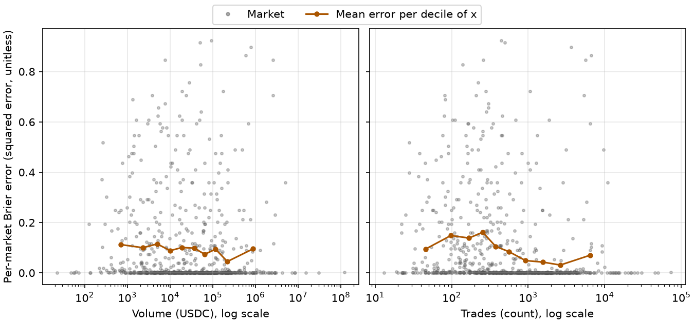

# Stage report: q1c_volume

**What:** Q1c: are busier markets more accurate?

**Why:** Q1c: do markets with more volume or more trades have a price closer to the outcome?

**Input data:** markets.parquet: 726 kept markets (with min_trades filter), real data. Volume and trade count cover all trades of the market in scope, not only those before T - 1 day.

**Output data:** q1c_scaled.csv, q1c_binned.csv, q1c_table.csv, q1c_results.json, fig11_volume_vs_error.png

**Result:** Primary: Spearman rho of log volume vs Brier error. Negative rho with p < 0.05 = busier is more accurate.

| x | n | rho (effect size) | 95% CI | p |
| --- | --- | --- | --- | --- |
| log1p(volume_usdc) | 726 | -0.146 | [-0.219, -0.072] | 7.84e-05 |
| log1p(n_trades) | 726 | -0.325 | [-0.390, -0.256] | 2.52e-19 |

**Figure:**   Caption: per-market Brier error against volume and trade count (log x) with the mean error per decile of x. Why: a falling line means busier markets have smaller errors. Source: this run folder.

**Status:** ran
