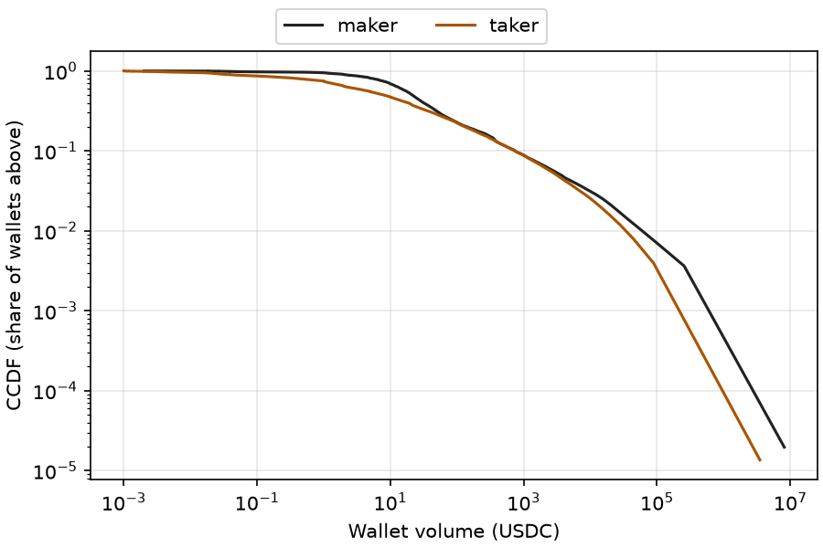
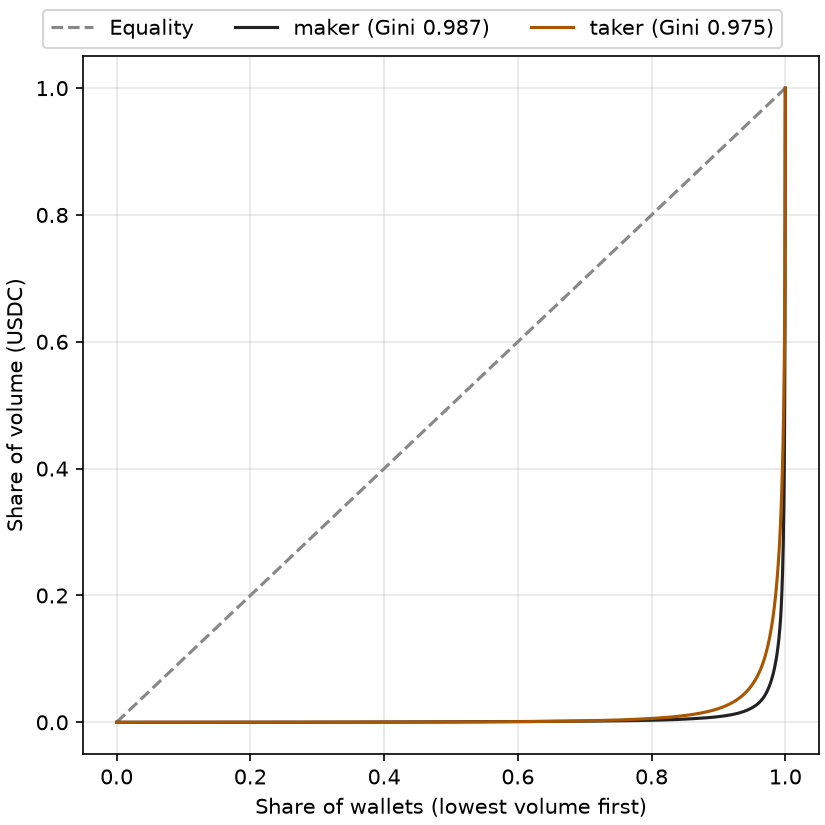
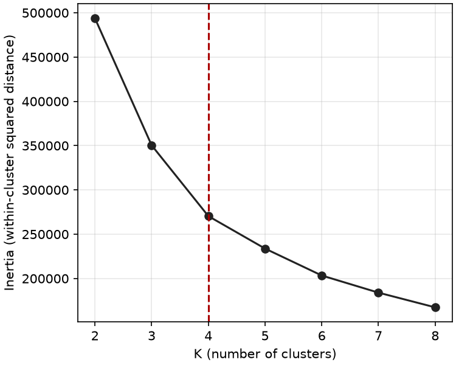

# Stage report: q2_concentration

**What:** Q2: volume concentration, Gini, role tests, k-means side analysis.

**Why:** Q2: how concentrated is volume across wallets (addresses), and do wallet groups differ?

**Input data:** wallets.parquet: 197543 wallet x role rows from kept markets. k-means on a fixed-seed sample of 197543 rows (a wallet in both roles has two rows).

**Output data:** q2_results.json, q2_concentration.csv, q2_clusters.csv, fig6_ccdf.png, fig7_lorenz.png, fig8_elbow.png

**Result:** | role | n_wallets | mean | median | top1_share | top5_share | top10_share | gini |
| --- | --- | --- | --- | --- | --- | --- | --- |
| maker | 5.084e+04 | 6084 | 21.45 | 0.8723 | 0.9773 | 0.9911 | 0.9868 |
| taker | 1.467e+05 | 2108 | 7.997 | 0.7416 | 0.9414 | 0.9784 | 0.9748 |

Paper Gini (full data, reference only): maker 0.97, taker 0.943. Welch t on log10 volume: d=0.442, p=0. KS D=0.271. Spearman rho(n_trades, volume)=0.622. K=4. Chi-square cluster x category: Cramer's V=0.386, p=0. ANOVA on log median trade size: eta^2=0.121, permutation p=0.000999.

**Figure:**     Caption: wallet volume CCDF (log-log), Lorenz curves, and the k-means elbow (dashed line = chosen K). Why: a curve far below the equality line means few wallets hold most volume. Source: this run folder.

**Status:** ran
