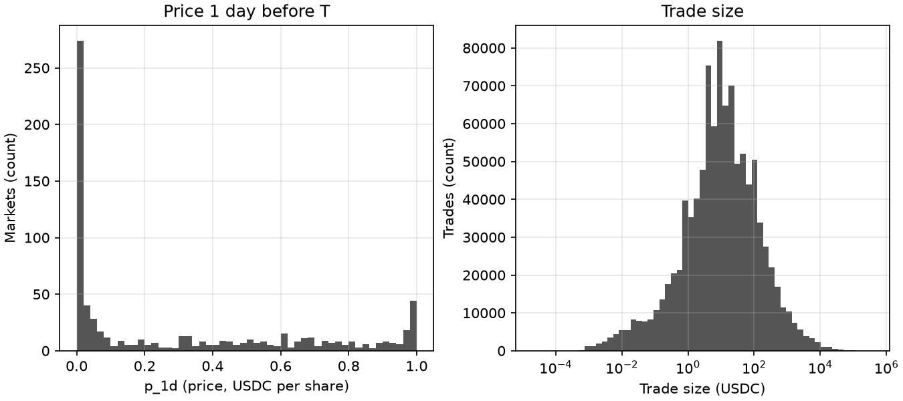
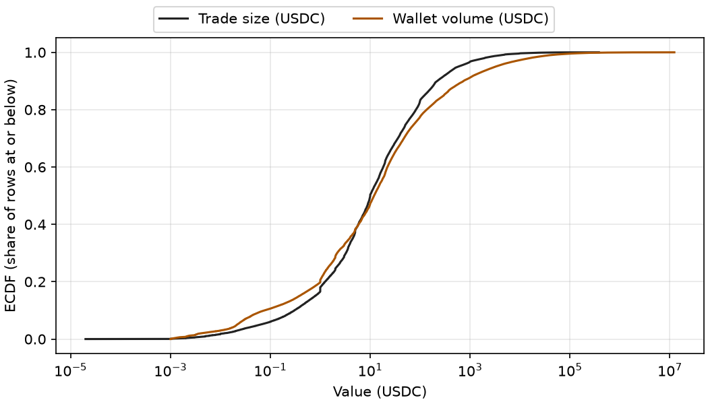
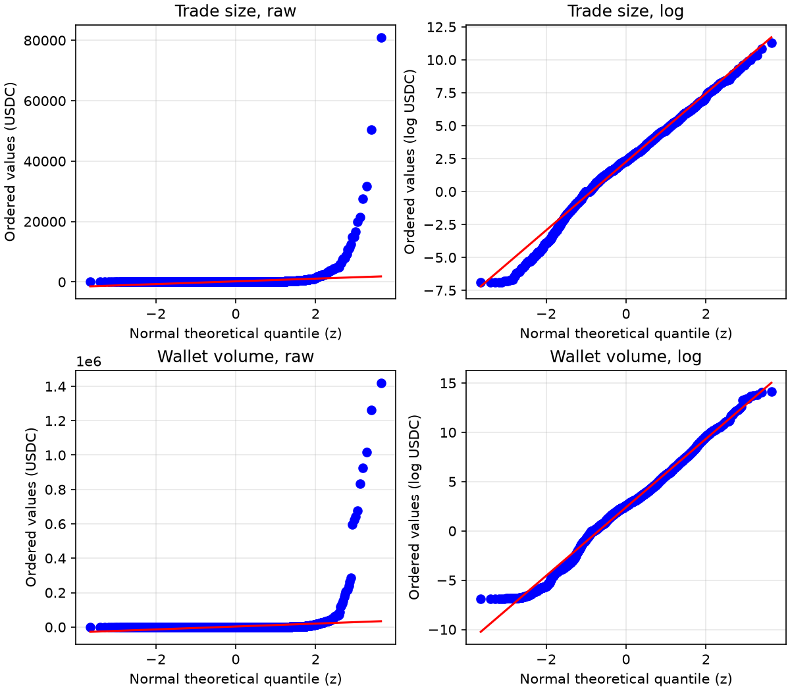

# Stage report: q3_describe

**What:** Q3: summary statistics, histograms, ECDF, distribution fits, QQ plots, KS tests.

**Why:** Q3: describe price, trade size and wallet volume before Q1 and Q2 use them.

**Input data:** markets.parquet kept markets (726), trade_sizes_sample.parquet (1000000 trades, fixed-seed sample), wallets.parquet (197543 wallet x role rows).

**Output data:** q3_results.json, q3_summary.csv, fig1_fig2_hist.png, ecdf.png, fig3_qq.png

**Result:** Summary:

| index | n | mean | median | mode_50bin_mid | range | variance |
| --- | --- | --- | --- | --- | --- | --- |
| p_1d | 726 | 0.3075 | 0.08 | 0.01098 | 0.998 | 0.1261 |
| trade_size_usdc | 1e+06 | 244.1 | 10 | 3799 | 3.799e+05 | 6.139e+06 |
| wallet_volume_usdc | 1.975e+05 | 3131 | 11.96 | 1.229e+05 | 1.229e+07 | 5.107e+09 |

Fits and KS (D is the effect size; p is optimistic because parameters are fitted on the same data; power law fitted on the top 10% tail with xmin = the 90% quantile):

| variable | model | KS D | KS p |
| --- | --- | --- | --- |
| trade_size_usdc | normal | 0.4608 | 0 |
| trade_size_usdc | exponential | 0.5649 | 0 |
| trade_size_usdc | power_law | 0.04443 | 5.209e-172 |
| wallet_volume_usdc | normal | 0.4825 | 0 |
| wallet_volume_usdc | exponential | 0.7655 | 0 |
| wallet_volume_usdc | power_law | 0.0551 | 1.409e-52 |

**Figure:**     Caption: price and trade-size histograms, ECDFs, and QQ plots before and after log. Why: a straight QQ line after log means the log-values are close to normal. Source: this run folder.

**Status:** ran
