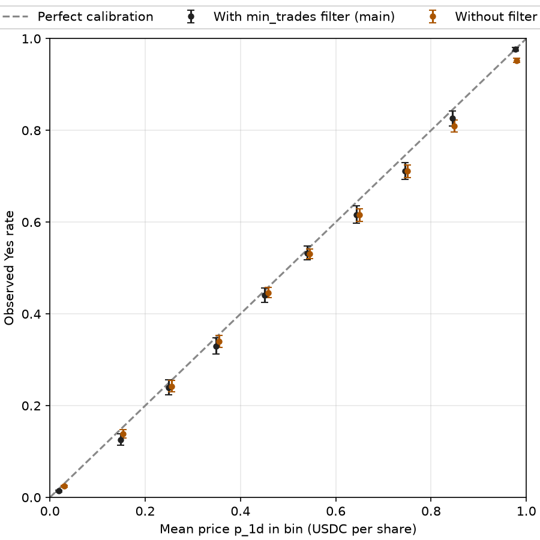
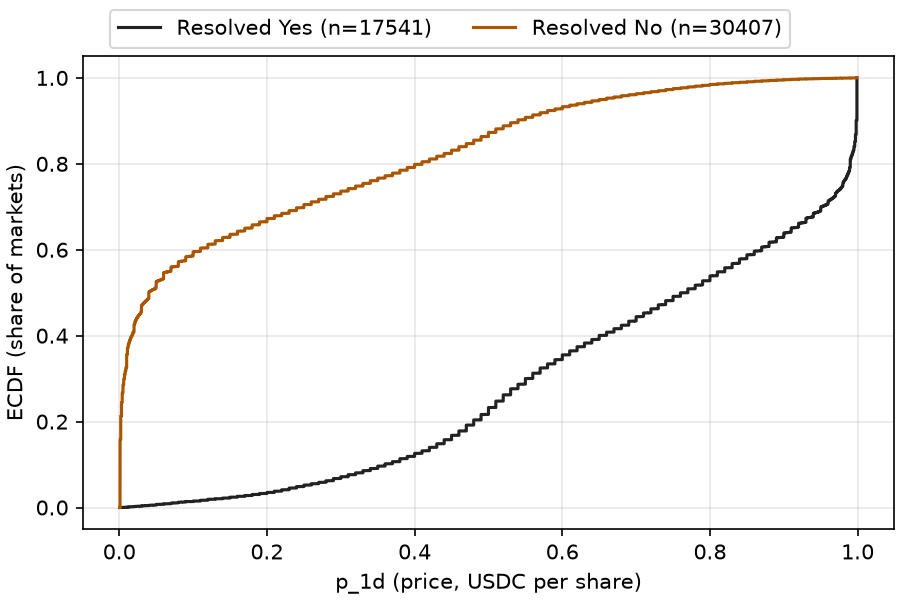

# Stage report: q1_calibration

**What:** Q1: calibration of the price 1 day before T.

**Why:** Q1: does the price 1 day before T match how often the outcome is Yes?

**Input data:** markets.parquet: 47948 kept markets (with filter), 74474 without the filter. T rule=close_at, min_trades=10. Real data.

**Output data:** q1_bins.csv, q1_bins_no_min.csv, q1_bins_eqfreq.csv, q1_results.json, q1_markets.csv, fig4_calibration.png, fig5_ecdf_yes_no.png

**Result:** | metric | with min filter | without filter |
| --- | --- | --- |
| n_markets | 47948 | 74474 |
| class_balance_yes | 0.3658 | 0.3811 |
| brier | 0.1071 | 0.1345 |
| log_loss | 0.3235 | 0.4032 |
| mean_entropy_bits | 0.475 | 0.5653 |
| chi2 (df) | 66.0 (10), p=2.6e-10 | 213.4 (10), p=2.54e-40 |
| chi2 effect w | 0.0371 | 0.05353 |
| KS D (Yes vs No) | 0.6731 | 0.5869 |

Bins rejected: Bonferroni 4, BH 5 of 10 (main).

| bin | n | mean_price | observed_rate | ci_low | ci_high | binom_p | p_bonferroni | p_bh |
| --- | --- | --- | --- | --- | --- | --- | --- | --- |
| 0 | 18224 | 0.01836 | 0.01388 | 0.01228 | 0.01569 | 3.055e-06 | 3.055e-05 | 3.055e-05 |
| 1 | 2695 | 0.1483 | 0.1258 | 0.1138 | 0.1388 | 0.0008535 | 0.008535 | 0.002845 |
| 2 | 2542 | 0.2492 | 0.2392 | 0.223 | 0.2562 | 0.2516 | 1 | 0.3145 |
| 3 | 2759 | 0.3488 | 0.3298 | 0.3125 | 0.3476 | 0.03776 | 0.3776 | 0.06293 |
| 4 | 3839 | 0.4501 | 0.4405 | 0.4248 | 0.4562 | 0.2364 | 1 | 0.3145 |
| 5 | 4248 | 0.5403 | 0.5325 | 0.5175 | 0.5475 | 0.3097 | 1 | 0.3441 |
| 6 | 2541 | 0.6434 | 0.6163 | 0.5972 | 0.635 | 0.00455 | 0.0455 | 0.01137 |
| 7 | 2312 | 0.7449 | 0.7119 | 0.6931 | 0.73 | 0.0003436 | 0.003436 | 0.001718 |
| 8 | 2131 | 0.8446 | 0.8264 | 0.8097 | 0.8419 | 0.02129 | 0.2129 | 0.04258 |
| 9 | 6657 | 0.9771 | 0.9772 | 0.9733 | 0.9805 | 1 | 1 | 1 |

**Figure:**    Caption: observed Yes rate against mean price per bin with 95% Wilson CI, and ECDFs of p_1d by outcome. Why: points on the diagonal mean the price matches the outcome rate. Source: this run folder.

**Status:** ran
