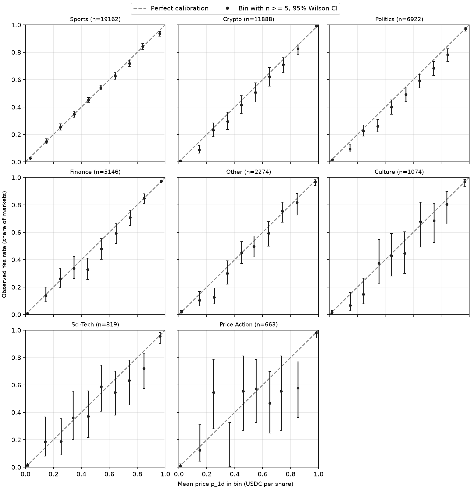

# Stage report: q1a_category

**What:** Q1a: does accuracy depend on the topic?

**Why:** Q1a: does the favorite win equally often in every topic, and is the price equally calibrated?

**Input data:** markets.parquet: 47948 kept markets (with min_trades filter), real data. Category = category_refined, categories under 30 markets merged into 'Other'. Favorite = side with p_1d >= 0.5.

**Output data:** q1a_contingency.csv, q1a_bins_by_category.csv, q1a_markets.csv, q1a_results.json, fig9_calibration_by_category.png

**Result:** Chi-square of independence: chi2=3193.906233433213, df=7, p=0.0, Cramer's V=0.25809276638886913 (min expected count 109.92846416951697).

Bin tests (n >= 5): 80 of 80 category x bin cells tested. Rejected: Bonferroni 2, BH 9.

Brier across categories: ANOVA F=835.6161807570338, p=0.0, eta squared=0.1087448957834779, permutation p=0.000999000999000999 (1000 perms, seed 42).

Under-represented: merged into 'Other': none. Sports: {'Sports': 19162}. Sports mostly drops out of the Standard Binary sample (plan, paper limitation 7).

n per category, favorite win rate and mean Brier:

| category | won | lost | n | favorite_win_rate | mean_brier |
| --- | --- | --- | --- | --- | --- |
| Sports | 13830 | 5332 | 19162 | 0.7217 | 0.1736 |
| Crypto | 11263 | 625 | 11888 | 0.9474 | 0.03729 |
| Politics | 5989 | 933 | 6922 | 0.8652 | 0.09185 |
| Finance | 4658 | 488 | 5146 | 0.9052 | 0.06654 |
| Other | 1945 | 329 | 2274 | 0.8553 | 0.09591 |
| Culture | 970 | 104 | 1074 | 0.9032 | 0.06642 |
| Sci-Tech | 727 | 92 | 819 | 0.8877 | 0.07894 |
| Price Action | 616 | 47 | 663 | 0.9291 | 0.04916 |

**Figure:**   Caption: observed Yes rate against mean price per bin, one panel per category, shared axes. Why: a panel off the diagonal shows a topic where the price is miscalibrated. Source: this run folder.

**Status:** ran
