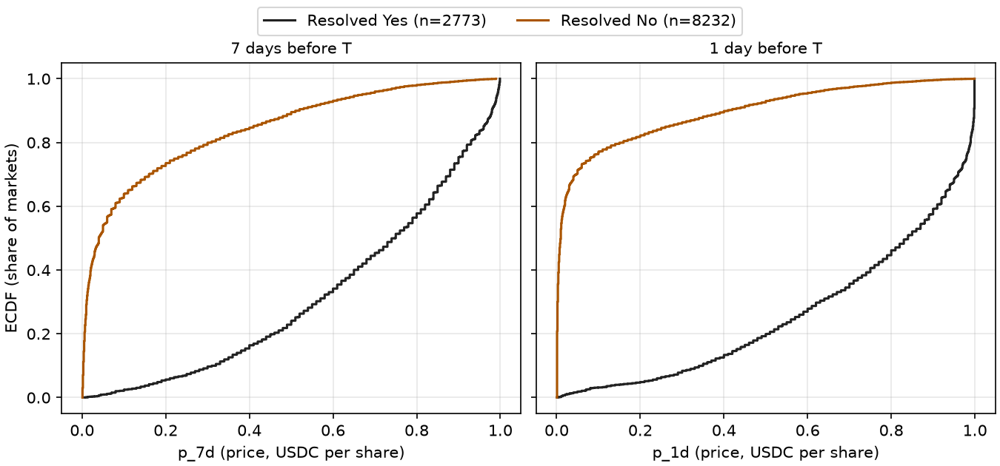

# Stage report: q1b_deadline

**What:** Q1b: does the market get smarter near the deadline?

**Why:** Q1b: is the price closer to the outcome 1 day before T than 7 days before T?

**Input data:** markets.parquet: 11005 markets of 47948 kept (21816 opened >= 7 d before T). Both prices at most 24 h old. Real data.

**Output data:** q1b_markets.csv, q1b_table.csv, q1b_results.json, fig10_ecdf_7d_vs_1d.png

**Result:** Primary: one-sample t-test of Brier difference (7 d - 1 d): mean=0.02568, 95% CI [0.02314, 0.02821], t=19.88 (df 11004), p=1.85e-86, Cohen's d=0.1895363573655312. Positive mean = better near the deadline.

Absolute error difference (7 d - 1 d): mean=0.05476, 95% CI [0.05174, 0.05778], p=2.59e-262, Cohen's d=0.3390015485578635.

The entropy drop is expected by construction: prices move toward 0 or 1 near the deadline. The error change is the real test.

| quantity | value | p |
| --- | --- | --- |
| Brier (7 d) | 0.0959 |  |
| Brier (1 d) | 0.07022 |  |
| mean H(p) bits (7 d) | 0.4531 |  |
| mean H(p) bits (1 d) | 0.3245 |  |
| mean H(p) change (7 d - 1 d) | 0.1286 |  |
| KS D Yes vs No (7 d) | 0.7047 | 1.55e-321 |
| KS D Yes vs No (1 d) | 0.785 | 0 |

**Figure:**   Caption: ECDFs of the price for Yes-resolved and No-resolved markets, at 7 days and at 1 day before T. Why: the further apart the two curves, the better the price separates the outcomes. Source: this run folder.

**Status:** ran
