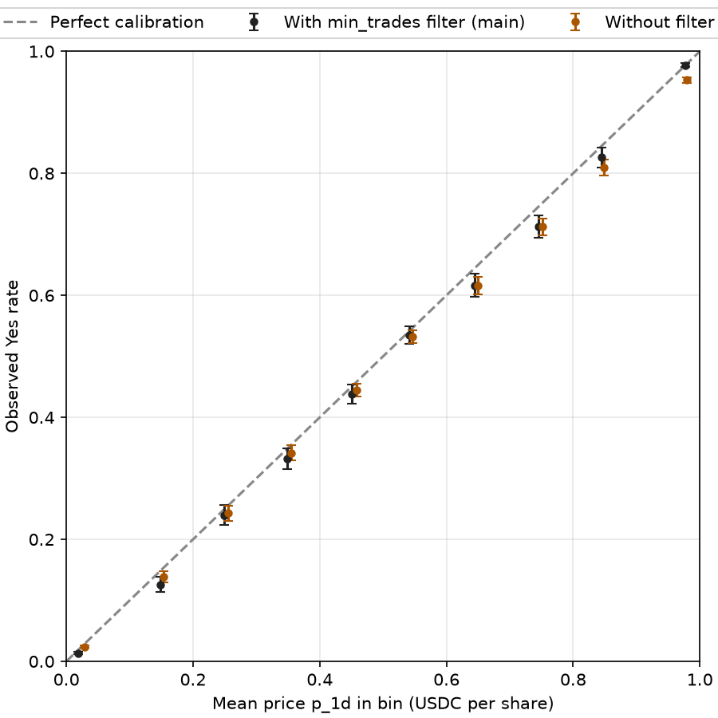
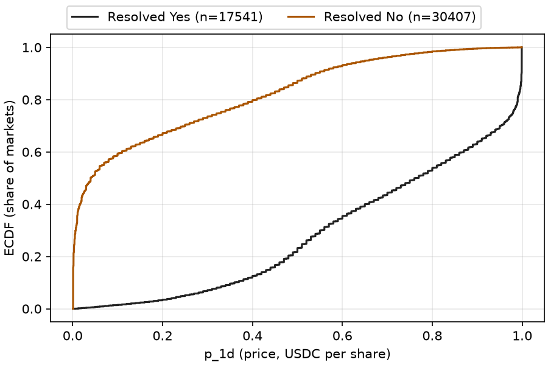

# Stage report: q1_calibration

**What:** Q1: calibration of the price 1 day before T.

**Why:** Q1: does the price 1 day before T match how often the outcome is Yes?

**Input data:** markets.parquet: 47948 kept markets (with filter), 74474 without the filter. T rule=close_at, min_trades=10. Real data.

**Output data:** q1_bins.csv, q1_bins_no_min.csv, q1_bins_eqfreq.csv, q1_results.json, q1_markets.csv, fig4_calibration.png, fig5_ecdf_yes_no.png

**Result:** | metric | with min filter | without filter |
| --- | --- | --- |
| n_markets | 47948 | 74474 |
| class_balance_yes | 0.3658 | 0.3811 |
| brier | 0.1071 | 0.1345 |
| log_loss | 0.3234 | 0.4031 |
| mean_entropy_bits | 0.4751 | 0.5652 |
| chi2 (df) | 68.0 (10), p=1.08e-10 | 214.2 (10), p=1.75e-40 |
| chi2 effect w | 0.03766 | 0.05363 |
| KS D (Yes vs No) | 0.6729 | 0.5865 |

Bins rejected: Bonferroni 4, BH 5 of 10 (main).

| bin | n | mean_price | observed_rate | ci_low | ci_high | binom_p | p_bonferroni | p_bh |
| --- | --- | --- | --- | --- | --- | --- | --- | --- |
| 0 | 18209 | 0.01825 | 0.01367 | 0.01209 | 0.01547 | 1.64e-06 | 1.64e-05 | 1.64e-05 |
| 1 | 2703 | 0.1484 | 0.1254 | 0.1135 | 0.1384 | 0.0006488 | 0.006488 | 0.002163 |
| 2 | 2543 | 0.2495 | 0.2395 | 0.2233 | 0.2565 | 0.2519 | 1 | 0.3149 |
| 3 | 2769 | 0.349 | 0.3319 | 0.3146 | 0.3497 | 0.05828 | 0.5828 | 0.09713 |
| 4 | 3859 | 0.4505 | 0.4382 | 0.4226 | 0.4539 | 0.1283 | 1 | 0.1833 |
| 5 | 4240 | 0.5407 | 0.5349 | 0.5199 | 0.5499 | 0.4502 | 1 | 0.5003 |
| 6 | 2553 | 0.6444 | 0.6165 | 0.5975 | 0.6352 | 0.003551 | 0.03551 | 0.008878 |
| 7 | 2301 | 0.7456 | 0.7127 | 0.6939 | 0.7309 | 0.0003598 | 0.003598 | 0.001799 |
| 8 | 2133 | 0.8453 | 0.8265 | 0.8099 | 0.842 | 0.01798 | 0.1798 | 0.03597 |
| 9 | 6638 | 0.9772 | 0.9776 | 0.9737 | 0.9809 | 0.9018 | 1 | 0.9018 |

**Figure:**    Caption: observed Yes rate against mean price per bin with 95% Wilson CI, and ECDFs of p_1d by outcome. Why: points on the diagonal mean the price matches the outcome rate. Source: this run folder.

**Status:** ran
