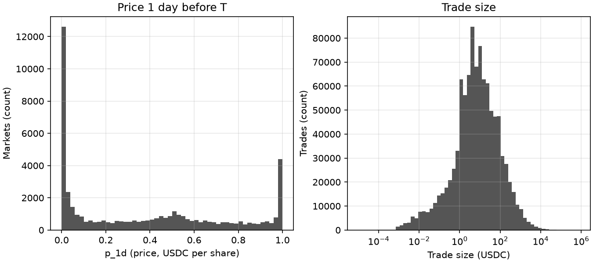
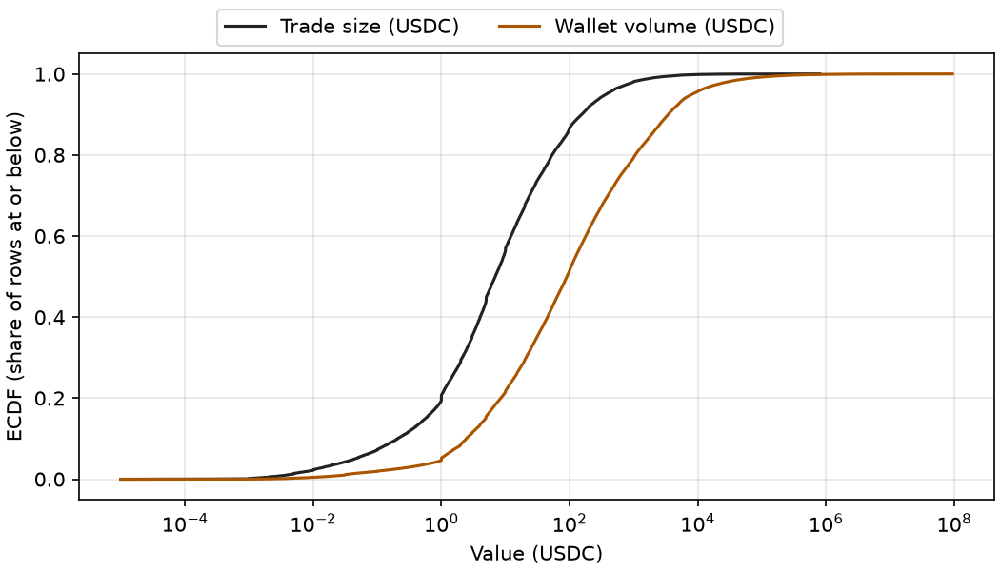
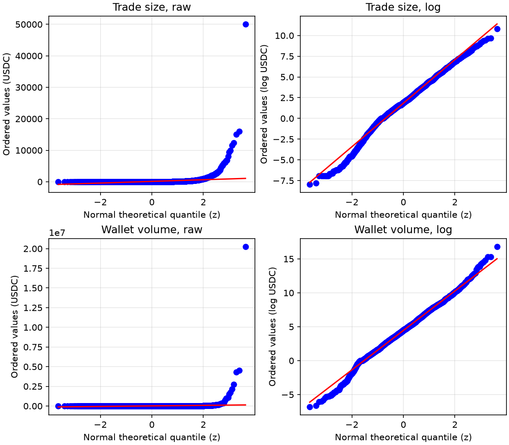
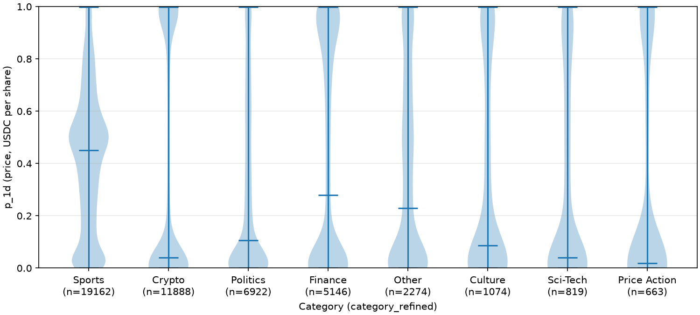

# Stage report: q3_describe

**What:** Q3: summary statistics, histograms, ECDF, distribution fits, QQ plots, KS tests.

**Why:** Q3: describe price, trade size and wallet volume before Q1 and Q2 use them.

**Input data:** markets.parquet kept markets (47948), trade_sizes_sample.parquet (1000000 trades, deterministic hash-order sample), wallets.parquet (2117412 wallet x role rows).

**Output data:** q3_results.json, q3_summary.csv, fig1_fig2_hist.png, ecdf.png, fig3_qq.png, fig_violin_p1d_by_category.png

**Result:** Summary:

| index | n | mean | median | mode_50bin_mid | range | variance |
| --- | --- | --- | --- | --- | --- | --- |
| p_1d | 4.795e+04 | 0.3757 | 0.32 | 0.01098 | 0.998 | 0.1262 |
| trade_size_usdc | 1e+06 | 129.8 | 6.93 | 7984 | 7.984e+05 | 2.716e+06 |
| wallet_volume_usdc | 2.117e+06 | 7745 | 91.11 | 9.388e+05 | 9.388e+07 | 6.802e+10 |

Fits and KS (D is the effect size; p is optimistic because parameters are fitted on the same data; power law fitted on the top 10% tail with xmin = the 90% quantile):

| variable | model | KS D | KS p |
| --- | --- | --- | --- |
| trade_size_usdc | normal | 0.4686 | 0 |
| trade_size_usdc | exponential | 0.5343 | 0 |
| trade_size_usdc | power_law | 0.03883 | 1.471e-131 |
| wallet_volume_usdc | normal | 0.4882 | 0 |
| wallet_volume_usdc | exponential | 0.6745 | 0 |
| wallet_volume_usdc | power_law | 0.02392 | 1.152e-105 |

**Figure:**      Caption: price and trade-size histograms, ECDFs, QQ plots before and after log, and p_1d by category (violin, bar = median). Why: a straight QQ line after log means the log-values are close to normal. Source: this run folder.

**Status:** ran
