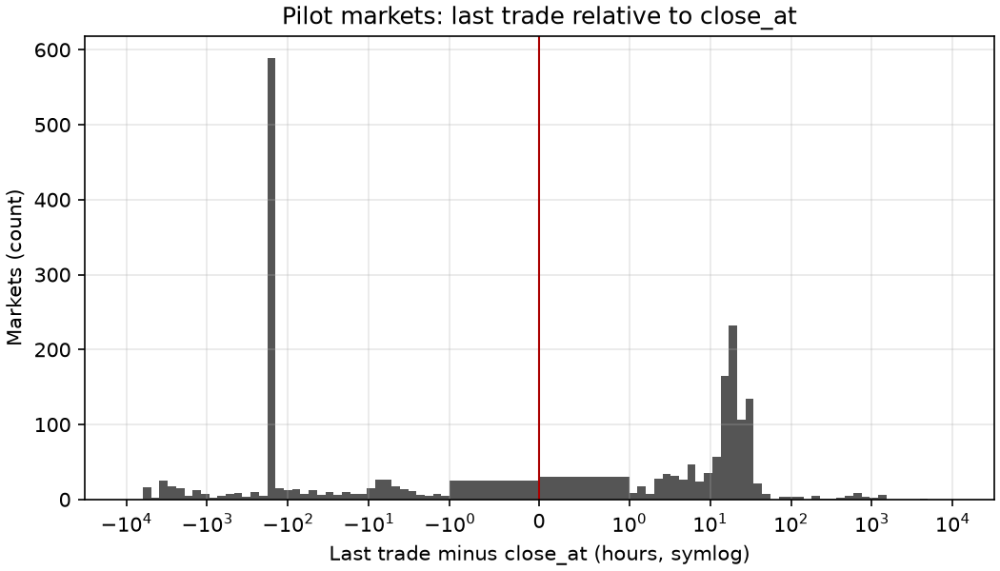

# Stage report: pilot_inspect

**What:** Inspect the pilot set (schema, Up/Down marking, duplicates, close time, activity).

**Why:** Fix the Up/Down marking, the close-time rule T and the minimum-activity cutoff before any Q1 result is seen.

**Input data:** Real data. Pilot = markets with close_at in 2025-06: 3841 markets, 3065179 trades (raw: data/polymarket_v1/daily_aligned/*.parquet). Standard Binary set: 2063 markets.

**Output data:** schema.csv, value_counts.csv, updown_check.csv, duplicates.json, close_time.csv, close_time_summary.json, activity.csv, activity_summary.json, missing.json, manifest.json, close_time_hist.png

**Result:** Duplicate rows: 155885 of 3065179. Markets with any trade after close_at: 0.513. Volume after close_at: 0.340. No winning label: 14.

| quantile | last_minus_close_h | resolved_minus_close_h |
| --- | --- | --- |
| 0 | -5295 | 32.22 |
| 0.05 | -766.3 | 34.31 |
| 0.25 | -163.4 | 42.67 |
| 0.5 | 0.8897 | 53.12 |
| 0.75 | 17.42 | 63.57 |
| 0.95 | 30.65 | 71.93 |
| 1 | 4438 | 74.02 |

**Figure:**   Caption: last trade minus close_at per market. Why: trades after close_at would leak the outcome into p_1d. Source: this run folder.

**Status:** ran
