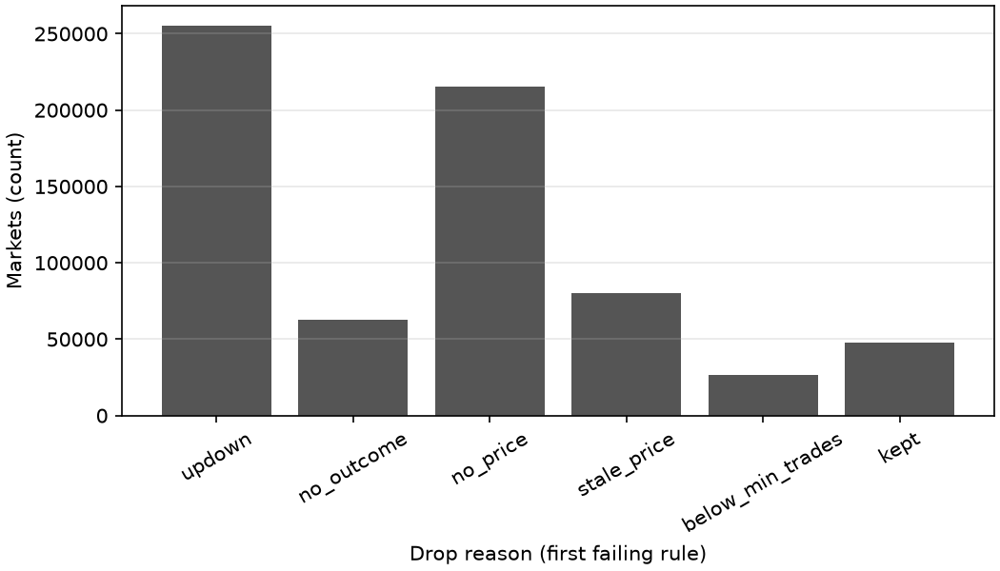

# Stage report: build_tables

**What:** Build the market table and the wallet table.

**Why:** Q1, Q2 and Q3 all read these two tables. Drop reasons are counted, nothing is imputed.

**Input data:** Real data, scope=full, T rule=close_at, min_trades=10, 688131 markets in scope (data/polymarket_v1/daily_aligned/*.parquet).

**Output data:** markets.parquet/csv (688131 rows), wallets.parquet (2117412 rows), trade_sizes_sample.parquet (1000000 rows max, rule: ORDER BY hash(t.condition_id, t.asset_id, t.ts, t.maker, t.taker, t.usdc_amount, t.p_event), t.condition_id, t.ts LIMIT 1000000), tables_summary.json

**Result:** Kept 47948 markets with the min_trades filter and 74474 without it. Of the kept, 21816 opened at least 7 days before T and 14169 have a p_7d.

| reason | markets |
| --- | --- |
| stale_price | 80230 |
| below_min_trades | 26526 |
| updown | 255420 |
| kept | 47948 |
| no_outcome | 62718 |
| no_price | 215289 |

**Figure:**   Caption: markets by first failing rule. Why: it shows which rule removes the most markets. Source: this run folder.

**Status:** ran
