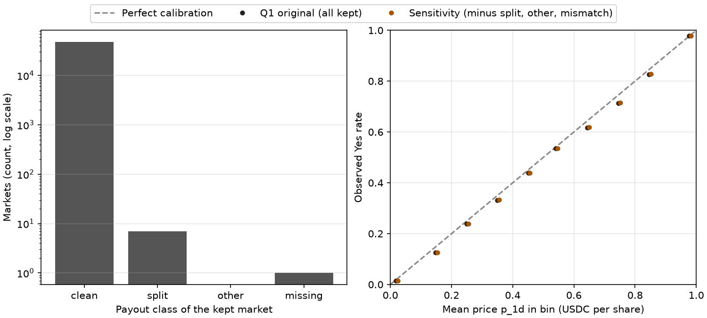

# Stage report: r1_split_payout

**What:** R1: split payouts and a Q1 sensitivity row.

**Why:** D-013: does the Q1 result hold when split, other and mismatching payouts are removed?

**Input data:** markets.parquet: 47948 kept markets. data/polymarket_v1/CTF/resolutions.parquet: 1313030 rows. Real data.

**Output data:** r1_markets.csv (one row per kept market), r1_results.json, fig_r1_split_payout.png

**Result:** | class | markets | share |
| --- | --- | --- |
| clean | 47940 | 0.9998 |
| split | 7 | 0.000146 |
| other | 0 | 0 |
| missing | 1 | 2.086e-05 |

Duplicates among kept ids: 0 (0 identical, 0 conflicting).

Agreement of our y with the resolutions winner (index 0): 0.9992 on 47940 clean markets (95% Wilson CI 0.9989 to 0.9994). Index used: 0. Mismatches: 40.

| metric | Q1 original | sensitivity |
| --- | --- | --- |
| n markets | 47948 | 47901 |
| chi2 (df) | 68.0 (10) | 64.3 (10) |
| p | 1.083e-10 | 5.565e-10 |
| Cohen's w | 0.03766 | 0.03663 |
| Brier | 0.1071 | 0.1068 |
| bins off (BH) | 5 | 4 |
| Q1 rule result | Prices are not calibrated as a whole at this n. | Prices are not calibrated as a whole at this n. |

Q1 rule results the same: True. Change in w: -0.001023.

**Figure:**   Caption: kept markets by payout class (log scale), and the Q1 calibration points with and without the unclear markets. Why: points that overlap mean the unclear markets do not move the result. Source: this run folder.

**Status:** ran
