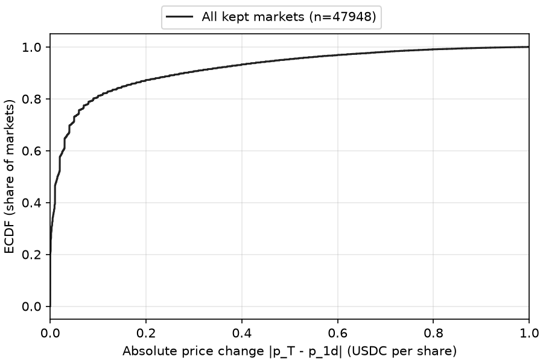

# Stage report: r2_price_path

**What:** R2: price path from T - 1 day to the last trade before T.

**Why:** D-013: how far does the price move between p_1d and the last trade before T?

**Input data:** markets.parquet: 47948 kept markets. Raw trades in the window T - 1 day < ts < T (data/polymarket_v1/daily_aligned/*.parquet). Real data.

**Output data:** r2_markets.csv (one row per kept market), r2_results.json, fig_r2_price_path.png

**Result:** | metric | all kept | with a trade in window |
| --- | --- | --- |
| n markets | 47948 | 45112 |
| median abs delta | 0.01533 | 0.02 |
| share_abs_delta_ge_0.10 | 0.1898 | 0.2017 |
| share_abs_delta_ge_0.25 | 0.1097 | 0.1166 |
| share_abs_delta_ge_0.50 | 0.04653 | 0.04945 |
| share crossing 0.5 | 0.08019 | 0.08523 |
| share no trade in window | 0.05915 | 0 |
| Brier at p_1d | 0.1071 | 0.1122 |
| Brier at p_T | 0.0749 | 0.07796 |
| mean diff (p_T minus p_1d) | -0.03218 | -0.0342 |
| 95% CI | -0.03329 to -0.03106 | -0.03538 to -0.03301 |
| p | 0 | 0 |
| Cohen's d_z | -0.2578 | -0.2663 |

Quantiles of abs(delta): q0.5 0.015, q0.75 0.060, q0.9 0.280, q0.95 0.482, q0.99 0.789, max 0.998.

By category (descriptive, no p-values):

| category | n | median_abs_delta | share_abs_delta_ge_0.10 | share_abs_delta_ge_0.25 | share_abs_delta_ge_0.50 | crossing | no_trade | brier_1d | brier_T | mean_diff |
| --- | --- | --- | --- | --- | --- | --- | --- | --- | --- | --- |
| Crypto | 11888 | 0.004 | 0.1693 | 0.09606 | 0.04475 | 0.04904 | 0.04584 | 0.03733 | 0.005143 | -0.03219 |
| Culture | 1074 | 0.01 | 0.1387 | 0.04376 | 0.0121 | 0.04469 | 0.07449 | 0.06615 | 0.05781 | -0.00834 |
| Finance | 5146 | 0.015 | 0.255 | 0.1374 | 0.06102 | 0.07618 | 0.07287 | 0.06652 | 0.02416 | -0.04236 |
| Other | 2274 | 0.011 | 0.1605 | 0.08707 | 0.03562 | 0.06596 | 0.07124 | 0.09594 | 0.07214 | -0.0238 |
| Politics | 6922 | 0.0125 | 0.1567 | 0.05056 | 0.01748 | 0.05995 | 0.09939 | 0.09169 | 0.07772 | -0.01396 |
| Price Action | 663 | 0.003 | 0.1644 | 0.1116 | 0.06486 | 0.06787 | 0.07541 | 0.04927 | 0.002217 | -0.04705 |
| Sci-Tech | 819 | 0.007333 | 0.1306 | 0.05861 | 0.02442 | 0.0525 | 0.0696 | 0.07893 | 0.06591 | -0.01303 |
| Sports | 19162 | 0.02 | 0.2067 | 0.1406 | 0.05777 | 0.1132 | 0.04587 | 0.1736 | 0.135 | -0.03865 |

**Figure:**   Caption: ECDF of the absolute price change from p_1d to p_T. Why: a curve near 1 at small values means p_1d is close to the last price. Source: this run folder.

**Status:** ran
