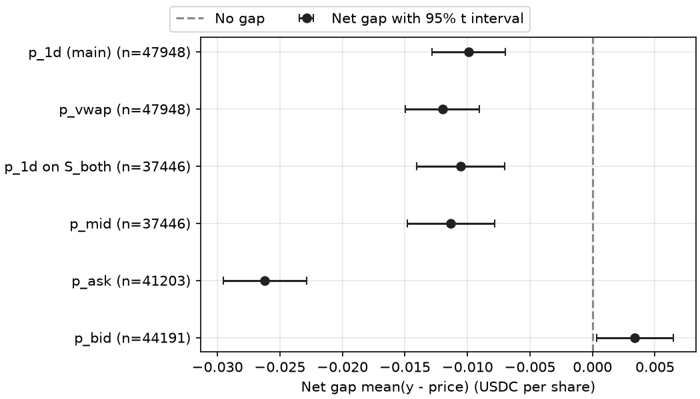

# Stage report: r3_m1

**What:** M1: price definition (VWAP and trade-based midpoint).

**Why:** M1: the reviewer says half the bid-ask spread could explain the net gap. p_vwap and a trade-based p_mid test that.

**Input data:** 47948 kept markets (r3_markets.parquet) and 4786979 kept-market trades in T - 2 days <= ts <= T - 1 day. Real data. p_mid is a trade-based proxy, not a quote midpoint.

**Output data:** m1_prices_by_market.csv, m1_results.json, fig_r3_m1_price_definition.png

**Result:** Sign gate: validated (median p_ask - p_bid on S_both 0.010000). Reading: A.

| row | n | chi2 | p | w | bins_off_bh | net_gap [95% CI] | d_z | agreement |
| --- | --- | --- | --- | --- | --- | --- | --- | --- |
| p_1d (main) | 47948 | 67.99 (10) | 1.083e-10 | 0.03766 | 5 | -0.0099 [-0.0128, -0.0070] | -0.0303 | same |
| p_vwap | 47948 | 177.96 (10) | 6.197e-33 | 0.06092 | 6 | -0.0120 [-0.0150, -0.0091] | -0.03642 | same |
| p_1d on S_both | 37446 | 47.28 (10) | 8.408e-07 | 0.03553 | 4 | -0.0105 [-0.0140, -0.0070] | -0.03034 | same |
| p_mid | 37446 | 106.86 (10) | 2.287e-18 | 0.05342 | 5 | -0.0113 [-0.0148, -0.0078] | -0.03274 | same |
| p_ask | 41203 | 310.87 (10) | 7.828e-61 | 0.08686 | 10 | -0.0262 [-0.0295, -0.0229] | -0.07572 | same |
| p_bid | 44191 | 45.26 (10) | 1.949e-06 | 0.032 | 2 | 0.0034 [0.0003, 0.0065] | 0.01034 | same |

Paired difference mean(p_1d - p_alt):

| pair | mean_diff | ci_low | ci_high | d_z | n |
| --- | --- | --- | --- | --- | --- |
| vwap_minus_1d | -0.002092 | -0.002654 | -0.001531 | -0.03337 | 47948 |
| mid_minus_1d_on_S_both | -0.0008008 | -0.001243 | -0.0003587 | -0.01835 | 37446 |

Coverage: {'n_vwap': 47948, 'n_S_both': 37446, 'share_S_both': 0.7809710519729707, 'n_ask_only': 3757, 'n_bid_only': 6745, 'n_vwap_missing': 0}. Counts: {'n_window_trades': 4786979, 'n_price_le_0': 0, 'n_side_0': 0}. Half-spread proxy h: {'n': 37446, 'mean': 0.01570153594617367, 'ci_low': 0.015286853112958972, 'ci_high': 0.016116218779388368, 'd_z': 0.3835177718141447, 'median': 0.0050000000000000044}. Side line: {'abs_net_gap_p1d': 0.00991151425407523, 'mean_h': 0.01570153594617367, 'gap_within_half_spread': True}.

**Figure:**   Caption: net gap under each price definition with its 95% t interval. Why: an interval left of 0 under p_vwap and p_mid means the gap is not a price-rule artifact. Source: this run folder.

**Status:** ran
