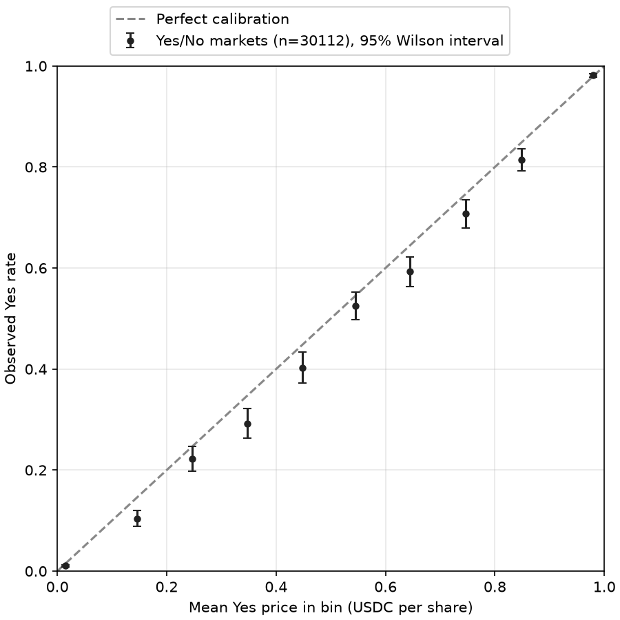

# Stage report: r3_m2

**What:** M2: Yes-oriented calibration.

**Why:** M2: 'outcome 1 is priced too high' mixes Yes/No markets with team-name markets. Is there a Yes-bias in Yes/No markets?

**Input data:** 47948 kept markets. Label 1 from 150296_v1label/label1_by_market.csv, label 2 rebuilt from raw. Real data.

**Output data:** m2_yes_by_market.csv, m2_bins_yes_no.csv, m2_bins_other.csv, m2_results.json, fig_r3_m2_yes_reliability.png

**Result:** | row | n | chi2 | p | w | bins_off_bh | net_gap [95% CI] | d_z | agreement |
| --- | --- | --- | --- | --- | --- | --- | --- | --- |
| Yes/No markets | 30112 | 100.14 (10) | 5.1e-17 | 0.05767 | 7 | -0.0132 [-0.0161, -0.0103] | -0.0516 | same |
| Other markets | 17836 | 14.96 (10) | 0.1335 | 0.02896 | 0 | -0.0043 [-0.0105, 0.0018] | -0.0103 | different |

Reading: In Yes/No markets, Yes is priced above its observed rate (proposal only, D-037 stays). Label 2 values where label 1 is yes: {'no': 30112, '(null)': 518}. n(Y) 30112 against the check bound 30112. Wilson intervals are outside the lectures (D-039); the z interval sits next to them in m2_bins_*.csv.

| bin | n | mean_price | observed_rate | gap | wilson_low | wilson_high | z_low | z_high |
| --- | --- | --- | --- | --- | --- | --- | --- | --- |
| 0 | 15008 | 0.0146 | 0.0103 | -0.0043 | -0.0058 | -0.0025 | -0.0059 | -0.0027 |
| 1 | 1358 | 0.1463 | 0.1031 | -0.0432 | -0.0582 | -0.0259 | -0.0594 | -0.027 |
| 2 | 1110 | 0.2471 | 0.2216 | -0.0255 | -0.0489 | -0.0001 | -0.0499 | -0.001 |
| 3 | 914 | 0.348 | 0.2921 | -0.0558 | -0.0844 | -0.0255 | -0.0853 | -0.0264 |
| 4 | 1013 | 0.4486 | 0.4028 | -0.0458 | -0.0756 | -0.0153 | -0.076 | -0.0156 |
| 5 | 1282 | 0.5455 | 0.525 | -0.0205 | -0.0479 | 0.0067 | -0.0479 | 0.0068 |
| 6 | 1051 | 0.6451 | 0.5928 | -0.0524 | -0.0824 | -0.0231 | -0.0821 | -0.0227 |
| 7 | 1017 | 0.7467 | 0.708 | -0.0388 | -0.0675 | -0.0116 | -0.0667 | -0.0108 |
| 8 | 1231 | 0.849 | 0.8148 | -0.0342 | -0.0568 | -0.0135 | -0.0559 | -0.0125 |
| 9 | 6128 | 0.9796 | 0.9819 | 0.0022 | -0.0014 | 0.0053 | -0.0011 | 0.0056 |

**Figure:**   Caption: observed Yes rate against mean Yes price in Yes/No markets. Why: points below the diagonal mean Yes is priced above its observed rate. Source: this run folder.

**Status:** ran
