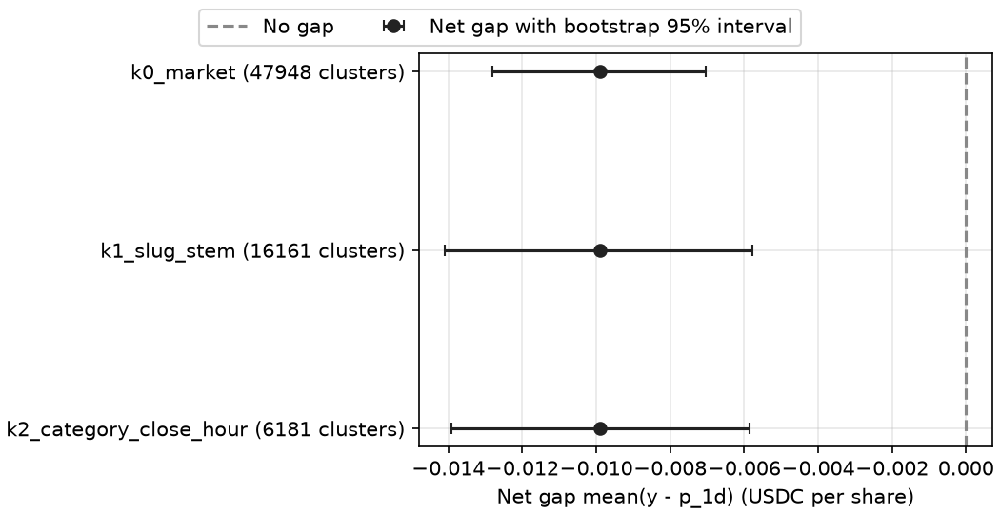

# Stage report: r3_m3

**What:** M3: cluster bootstrap with proxy event keys.

**Why:** M3: markets of one event move together, but the tests assume independent markets. No event key exists, so proxies stand in.

**Input data:** 47948 kept markets (market_slug, category_refined, close_at). Real data. Proxies: K1 first 3 slug tokens, K2 category x close hour (NULL category = Unknown). B 2000, seed 20261107.

**Output data:** m3_clusters.csv, m3_bootstrap.json, m3_results.json, fig_r3_m3_cluster_bootstrap.png

**Result:** | proxy | clusters | median size | max size | share in size-1 | X2_cl (df) | p | w_cl | bins off BH | net gap [95% CI] | agreement |
| --- | --- | --- | --- | --- | --- | --- | --- | --- | --- | --- |
| k0_market | 47948 | 1 | 1 | 1 | 74.6 (10) | 5.713e-12 | 0.03944 | 5 | -0.0099 [-0.0128, -0.0070] | same |
| k1_slug_stem | 16161 | 1 | 2087 | 0.2177 | 62.8 (10) | 1.05e-09 | 0.0362 | 4 | -0.0099 [-0.0141, -0.0058] | same |
| k2_category_close_hour | 6181 | 3 | 281 | 0.04144 | 58.5 (10) | 7.034e-09 | 0.03492 | 4 | -0.0099 [-0.0139, -0.0058] | same |

Read proxy (wider net gap interval): k1_slug_stem. Robust to the proxy: True. K0 method check (+-0.05): passed. X2_cl is outside the lectures (D-039): compare K1 or K2 with K0, not with 67.99. It ignores covariance between bins.

**Figure:**   Caption: net gap with bootstrap 95% interval per clustering. Why: a wider interval under K1 or K2 than under K0 shows dependence between markets. Source: this run folder.

**Status:** ran
