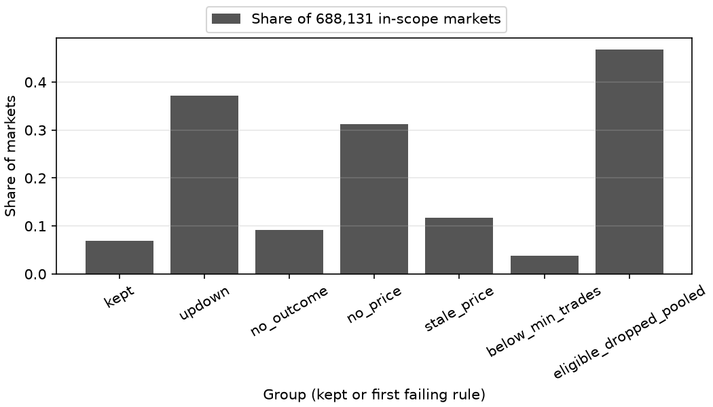

# Stage report: r3_m4

**What:** M4: kept versus dropped markets.

**Why:** M4: only 47,948 of 688,131 markets stay. Does the kept set differ from the markets that were dropped?

**Input data:** 688131 in-scope markets (r3_markets.parquet, drop_reason). Volume before T - 1 day from the raw pass. Real data.

**Output data:** m4_kept_vs_dropped.csv, m4_results.json, fig_r3_m4_kept_vs_dropped.png

**Result:** | group | n | share_of_total | volume_before_T1d_median | duration_days_median | n_trades_median | outcome1_rate |
| --- | --- | --- | --- | --- | --- | --- |
| kept | 47948 | 0.06968 | 1790 | 6.995 | 292.5 | 0.3658 |
| updown | 255420 | 0.3712 | 14.86 | 0.9973 | 623 | 0.4957 |
| no_outcome | 62718 | 0.09114 | 3.743 | 5.06 | 5 | nan |
| no_price | 215289 | 0.3129 | nan | 4.608 | 14 | 0.3361 |
| stale_price | 80230 | 0.1166 | 137.8 | 8.516 | 23 | 0.3946 |
| below_min_trades | 26526 | 0.03855 | 12.33 | 6.442 | 63 | 0.4088 |
| eligible_dropped_pooled | 322045 | 0.468 | 69 | 6.368 | 17 | 0.3566 |

Calibration of dropped markets that have a price (net gap with t interval, mean squared residual):

| group | n | net_gap | net_gap_ci_low | net_gap_ci_high | mean_sq_residual |
| --- | --- | --- | --- | --- | --- |
| stale_price | 80230 | -0.003538 | -0.004846 | -0.002229 | 0.03577 |
| below_min_trades | 26526 | -0.01103 | -0.01619 | -0.005867 | 0.1841 |

Q1 analysis on stale_price (w next to p):

| row | n | chi2 | p | w | bins_off_bh | net_gap [95% CI] | d_z | agreement |
| --- | --- | --- | --- | --- | --- | --- | --- | --- |
| stale_price | 80230 | 448.95 (10) | 3.491e-90 | 0.07481 | 3 | -0.0035 [-0.0048, -0.0022] | -0.01871 | same |

Descriptive. Medians and interquartile ranges carry the comparison (all columns in the CSV).

**Figure:**   Caption: share of in-scope markets by group. Why: it shows how much of the market set each drop rule removes. Source: this run folder.

**Status:** ran
