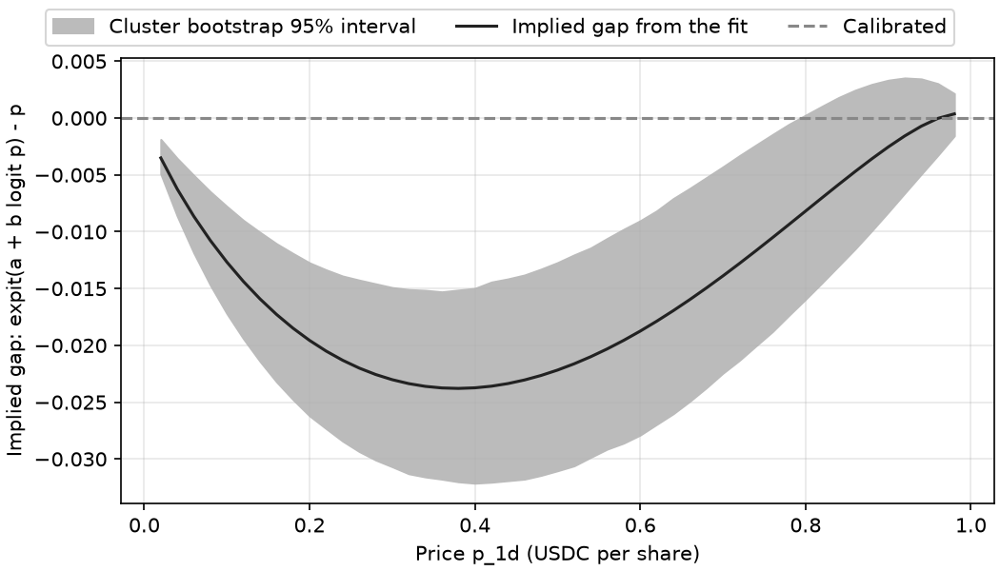

# Stage report: r3_m5

**What:** M5: practical size of the miscalibration.

**Why:** M5: the chi-square p is tiny but w is 0.0377. How large is the miscalibration in usable terms?

**Input data:** 47948 kept markets (p_1d, y). Bootstrap draws of the read proxy k1_slug_stem (M3). Real data.

**Output data:** m5_calibration_fit.json, m5_results.json, fig_r3_m5_implied_gap.png

**Result:** a -0.0888 (Wald -0.1163 to -0.0612), b 1.0277 (Wald 1.0054 to 1.0500). b < 1: prices too extreme. Clipped 542. Failed refits 0.

| price | delta | ci_low | ci_high | practically_sized |
| --- | --- | --- | --- | --- |
| 0.05 | -0.007494 | -0.0103 | -0.004319 | False |
| 0.1 | -0.01268 | -0.01721 | -0.007782 | False |
| 0.25 | -0.02167 | -0.0289 | -0.0141 | False |
| 0.5 | -0.02218 | -0.03103 | -0.01272 | False |
| 0.75 | -0.0111 | -0.01946 | -0.001923 | False |
| 0.9 | -0.002544 | -0.008278 | 0.003328 | False |
| 0.95 | -0.0003469 | -0.004101 | 0.003279 | False |

Practical line (mean h from M1): 0.01570153594617367. Brier 0.1071, climatology 0.2320, skill score 0.5385 (in-sample climatology). Majority accuracy 0.6342, accuracy at 0.5 0.8343. Logistic calibration and the skill score are outside the lectures (D-039).

**Figure:**   Caption: implied gap between the fitted probability and the price. Why: a band that excludes 0 at a price shows the gap there is not noise. Source: this run folder.

**Status:** ran
