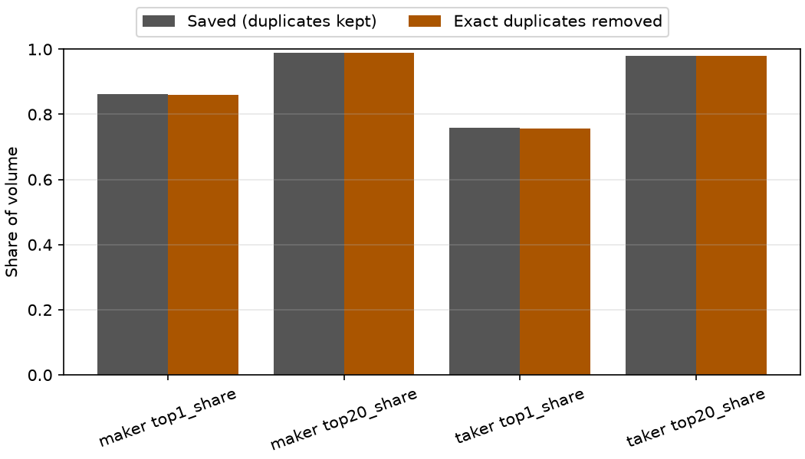

# Stage report: r3_minor4

**What:** Minor 4: exact duplicate rows.

**Why:** Minor 4: the pilot found 5% exact duplicate rows. MVP1 keeps them. Do the Q1 and Q2 results survive removing them?

**Input data:** Raw trades of the 47948 kept markets (data/polymarket_v1/daily_aligned/*.parquet), all 24 columns for the exact-duplicate key. Real data.

**Output data:** minor4_dedup.json, minor4_results.json, fig_r3_minor4_q2_shares.png

**Result:** Duplicates: {'n_rows': 63023987, 'n_distinct_all_columns': 61097503, 'n_dup_all_columns': 1926484, 'share_dup_all_columns': 0.030567472667192574, 'n_distinct_pilot_key': 61097447, 'n_dup_pilot_key': 1926540, 'share_dup_pilot_key': 0.030568361217769353}. Kept set: {'n_in': 47948, 'n_out': 47809, 'n_removed': 139, 'p1d_changed_in_new_kept': 281}.

| row | n | chi2 | p | w | bins_off_bh | net_gap [95% CI] | d_z | agreement |
| --- | --- | --- | --- | --- | --- | --- | --- | --- |
| deduplicated kept set | 47809 | 67.39 (10) | 1.411e-10 | 0.03754 | 5 | -0.0099 [-0.0128, -0.0069] | -0.03017 | same |

Q2 top shares (descriptive, delta in percentage points, no verdict):

| role | share | saved | dedup | delta_pp |
| --- | --- | --- | --- | --- |
| maker | top1_share | 0.8612 | 0.8595 | -0.1643 |
| maker | top20_share | 0.9886 | 0.9884 | -0.01562 |
| taker | top1_share | 0.759 | 0.7563 | -0.2648 |
| taker | top20_share | 0.9801 | 0.9798 | -0.02874 |

**Figure:**   Caption: top 1% and top 20% volume shares with and without exact duplicates. Why: equal bars mean duplicates do not drive the concentration result. Source: this run folder.

**Status:** ran
