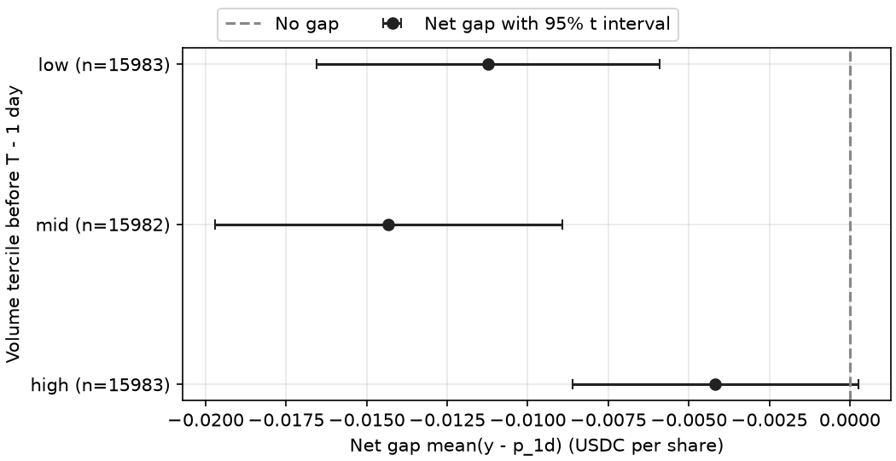
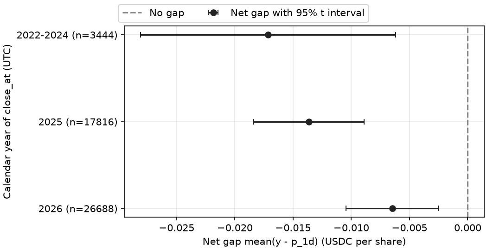

# Stage report: r3_peer

**What:** Peer asks: volume tercile and close period.

**Why:** Peer asks: does the gap depend on volume (Gorabi) or on the period (Molina)?

**Input data:** 47948 kept markets. Volume before T - 1 day from the raw pass. Real data.

**Output data:** peer_a_results.json, peer_a_volume_x_odds.csv (3 terciles x 10 bins, cells with n < 30 marked small), peer_b_results.json, fig_r3_peer_a_volume.png, fig_r3_peer_b_period.png

**Result:** (a) Volume tercile (BH over 3 chi-square p-values):

| row | n | chi2 | p | w | bins_off_bh | net_gap [95% CI] | d_z | agreement | p_bh |
| --- | --- | --- | --- | --- | --- | --- | --- | --- | --- |
| low | 15983 | 40.31 (10) | 1.495e-05 | 0.05022 | 3 | -0.0112 [-0.0166, -0.0059] | -0.03269 | same | 2.243e-05 |
| mid | 15982 | 45.04 (10) | 2.138e-06 | 0.05309 | 4 | -0.0143 [-0.0197, -0.0089] | -0.04123 | same | 6.415e-06 |
| high | 15983 | 14.16 (10) | 0.166 | 0.02976 | 0 | -0.0042 [-0.0086, 0.0003] | -0.01457 | different | 0.166 |

Cut points (USDC before T - 1 day): 498.51, 6207.45. High minus low net gap (Welch): {'diff': 0.007066802067287836, 'ci_low': 0.00013002988434861716, 'ci_high': 0.014003574250227056, 't': 1.9967816137041976, 'p': 0.04585765272431584, 'cohens_d': 0.02233656657697738}.

(b) Close period (BH over the period p-values):

| row | n | chi2 | p | w | bins_off_bh | net_gap [95% CI] | d_z | agreement | p_bh |
| --- | --- | --- | --- | --- | --- | --- | --- | --- | --- |
| 2022-2024 | 3444 | 25.13 (10) | 0.005108 | 0.08542 | 0 | -0.0171 [-0.0281, -0.0062] | -0.05238 | same | 0.007661 |
| 2025 | 17816 | 76.34 (10) | 2.612e-12 | 0.06546 | 5 | -0.0136 [-0.0184, -0.0089] | -0.04223 | same | 7.835e-12 |
| 2026 | 26688 | 15.82 (10) | 0.105 | 0.02435 | 0 | -0.0065 [-0.0104, -0.0025] | -0.01968 | different | 0.105 |

Year to period: {'2022': '2022-2024', '2023': '2022-2024', '2024': '2022-2024', '2025': '2025', '2026': '2026'}.

Descriptive, no verdict.

**Figure:**    Caption: net gap with 95% t interval per volume tercile and per close period. Why: intervals that overlap mean no sign that the gap changes. Source: this run folder.

**Status:** ran
