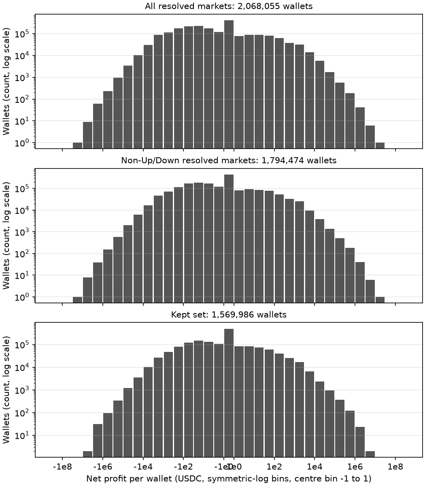

# Stage report: pnl_wallets

**What:** Net profit and loss per wallet from resolved markets.

**Why:** Owner request 2026-11-16: how much money each wallet won or lost. Descriptive, for a later tips page. Not in the report or the paper.

**Input data:** Real data, raw trades (data/polymarket_v1/daily_aligned/*.parquet) and the scope flags of /home/taeklim01/cs6344_polymarket/runs/142123_robust_full_v4/markets.parquet. 688131 markets in scope, 548340 with a usable winner, 596196865 fills in them.

**Output data:** wallet_pnl.parquet (5432515 rows, one per wallet x scope), pnl_summary.json, market_check.csv (548340 markets), fig_pnl_distribution.png.

**Result:** Kept set: 1569986 wallets, 663072 winners, 871667 losers. Short positions in kept markets: 0.5895818009464495 of positions (mint or merge counter-legs are not modelled). Checks failed: n_kept_not_usable=1014.

| scope | wallets | winners | losers | zero | total_won_usdc | total_lost_usdc | sum_pnl_net_usdc | median_pnl_net_usdc |
| --- | --- | --- | --- | --- | --- | --- | --- | --- |
| all | 2068055 | 693490 | 1345431 | 29134 | 6.527e+08 | 1.225e+09 | -5.722e+08 | -3.522 |
| non_updown | 1794474 | 679182 | 1083047 | 32245 | 5.488e+08 | 7.451e+08 | -1.963e+08 | -1 |
| kept | 1569986 | 663072 | 871667 | 35247 | 3.521e+08 | 4.47e+08 | -9.482e+07 | -0.1992 |

**Figure:**   Caption: wallets by net profit, symmetric-log bins. Why: it shows how many wallets sit near zero and how long the tails are. Source: this run folder.

**Status:** ran, check failures: n_kept_not_usable=1014
